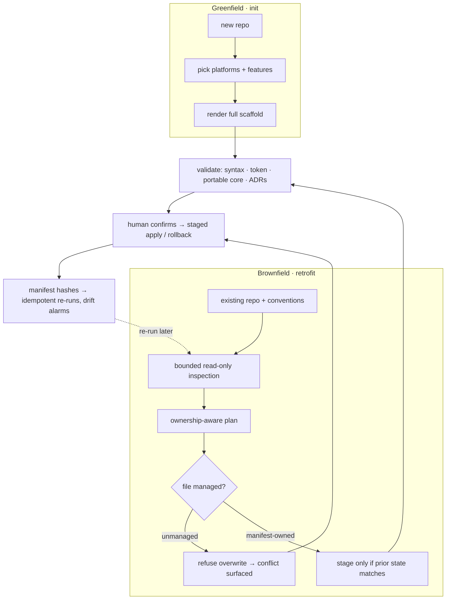

# Refract

Bootstrap greenfield or existing projects with provider-neutral instructions for Claude Code, Codex, Pi, OpenCode, and OhMyPi (omp). Integrations and privileged behavior remain opt-in.

## How it works

Both project types converge on the same managed, validated, ownership-tracked state:



## Use with an agent

Point your coding agent at this repository and let it drive the bootstrap; the agent previews but never applies.

1. The agent runs bounded inspection and a dry-run preview:

   ```bash
   refract inspect --target /path/to/project

   refract retrofit \
     --agent-guided \
     --agent-intent /outside/project/intent.json \
     --dry-run \
     --plan-format json \
     --target /path/to/project
   ```

2. The agent stops and shows the plan identifier. You apply in your own interactive terminal:

   ```bash
   refract retrofit \
     --agent-guided \
     --agent-intent /outside/project/intent.json \
     --expected-plan PLAN_SHA256 \
     --target /path/to/project
   ```

After bootstrap, the generated `AGENTS.md`, progressive-disclosure docs, deterministic validators, and the project-scoped `refract` skill steer the agent through the development process. See the [agent-guided protocol](docs/AGENT_GUIDED.md) for roles, trust boundaries, and plan integrity.

### Copy-paste prompt

Install Refract once (`pip install /path/to/refract`), then paste this into your agent from your project root:

```text
Add Refract to this project in advisory mode. You may inspect and preview, but you
must never modify project files, stage, commit, or apply anything — the human applies.

1. If the `refract` CLI is unavailable, clone
   https://github.com/BlasterSystems/refract and `pip install <checkout>`.

2. Bounded, read-only inspection (JSON evidence only; do not add --include-snippets):

   refract inspect --target .

3. From the evidence, write a strict proposal to /tmp/refract-intent.json (outside
   this repo). Only these fields are accepted; anything else is rejected:

   {
     "schema": "refract-intent/v1",
     "project": {
       "name": "<from evidence>",
       "description": "<from evidence>",
       "build_command": "<from evidence or null>",
       "test_command": "<from evidence or null>",
       "run_command": null,
       "ticket_prefix": null
     },
     "features": {
       "platforms": ["<harnesses this project uses>"],
       "mcp": false,
       "agents": false,
       "github": false,
       "scheduled_audit": false,
       "hooks": false
     }
   }

   Valid platforms: claude, codex, pi, opencode, omp. Leave every privileged
   feature false and ask me before enabling any. Never include credentials, file
   contents, or fields outside the schema. Do not read .env, key files, or other
   known secret locations.

4. Deterministic dry-run preview (writes only to stdout):

   refract retrofit --agent-guided --agent-intent /tmp/refract-intent.json \
     --dry-run --plan-format json --target .

5. STOP. Report the plan identifier and every planned operation. Flag any update
   or removal of an existing file for exact diff review in my terminal, plus any
   conflicts (unmanaged files are never overwritten). Do not apply.

6. Wait for me. I will apply in my own interactive terminal:

   refract retrofit --agent-guided --agent-intent /tmp/refract-intent.json \
     --expected-plan <PLAN_SHA256> --target .
```

## Supported harnesses

First-class adapters generate native artifacts for:

- Claude Code (`CLAUDE.md`, `.claude/`, `.mcp.json`)
- OpenAI Codex (`AGENTS.md`, `.codex/config.toml`, `.codex/agents/`)
- Pi Coding Agent (`AGENTS.md`, `.agents/skills`)
- OpenCode (`AGENTS.md`, `.agents/skills`, `opencode.json`, `.opencode/`)
- OhMyPi (omp) — portable core natively plus a sticky `.omp/RULES.md` invariant file (omp discovers `AGENTS.md` and `.agents/skills` by default, reads root `mcp.json` / `.mcp.json` as an MCP fallback, and also loads `CLAUDE.md`)

See the [platform support matrix](docs/PLATFORM_SUPPORT.md) for verified versions and support levels.

## Quick start

Requires Python 3.11+.

Clone or download this repository, then run from its checkout:

```bash
cd refract
python3 -m pip install -e .

# Preview an all-platform project without writing files
refract init --platform all --dry-run --yes --target /path/to/project

# Initialize a minimal Pi-compatible project
refract init --platform pi --yes --target /path/to/project

# Add the portable core and selected adapters to an existing project
refract retrofit --platform claude,codex,pi,opencode \
  --dry-run --yes --target /path/to/project

# Inspect bounded evidence without changing the project
refract inspect --target /path/to/project

# Validate generated configuration
refract validate --target /path/to/project
```

The repository-local entry point works without installation:

```bash
scripts/refract.sh init --platform all --dry-run --yes --target /path/to/project
```

## Optional features

```text
--mcp              Native MCP configuration where supported
--agents           Specialized-agent definitions where supported
--github           GitHub documentation-check workflow
--scheduled-audit  Weekly docs-check schedule; implies --github
--hooks            Git hooks without changing Git configuration
--answers FILE     Confirmed project and feature answers as JSON
--agent-guided     LLM-advisory preview with separate human apply
--agent-intent FILE Strict unverified proposal for agent-guided mode
--expected-plan ID Integrity check for interactive human apply
--plan-format json Machine-readable plan
--remove-obsolete  Explicitly remove obsolete manifest-owned files
```

See the [answers-file reference](docs/ANSWERS.md) for trusted-caller JSON and the [agent-guided protocol](docs/AGENT_GUIDED.md) for bounded inspection, typed proposals, preview, and trusted-terminal handoff. Unmanaged files are never overwritten; start with `--dry-run` when retrofitting.

## Documentation: load progressively

Read only what the current task requires:

1. **Start here:** [documentation index](docs/README.md)
2. **Contributing:** [development process](docs/DEVELOPMENT_PROCESS.md)
3. **Architecture:** [architecture overview](docs/ARCHITECTURE.md), then the [ADR index](docs/adr/README.md) before individual decisions
4. **Platform details:** [support matrix](docs/PLATFORM_SUPPORT.md)
5. **Generated files:** [exact all-feature output](docs/GENERATED_OUTPUT.md)
6. **Releases:** [Semantic Versioning and Git tags](docs/RELEASING.md)
7. **Knowledge strategy:** [LLM Wiki evaluation and pilot plan](docs/LLM_WIKI_EVALUATION.md)

## Development

```bash
PYTHONPATH=src python3 -m unittest discover -s tests -v
PYTHONPATH=src python3 -m refract validate --target .
```

## Credits

- [Cloudflare security-audit-skill](https://github.com/cloudflare/security-audit-skill) — the optional security-audit integration ([ADR-0006](docs/adr/0006-opt-in-security-audit-skill.md)) documents and orchestrates this MIT-licensed skill. The skill itself is installed on demand and remains the work of its authors.
- [addyosmani/agent-skills](https://github.com/addyosmani/agent-skills) and [emiliosheinz/agent-skills](https://github.com/emiliosheinz/agent-skills) — the optional task-breakdown and ticket-creation integrations ([ADR-0007](docs/adr/0007-install-on-demand-task-breakdown-skills.md)) document these MIT-licensed skills, installed on demand.
- [vercel-labs/skills](https://github.com/vercel-labs/skills) — the open skills CLI that the documented `npx skills add` install flows for both integrations run on.
- [gitleaks](https://github.com/gitleaks/gitleaks) — optional staged-change credential scan in the generated Git pre-commit hook.

## License

Apache-2.0 — see [LICENSE](LICENSE).
