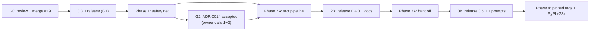

# Implementation plan: entry-path consolidation

Turns [the design](research-entry-path-consolidation.md) and [ADR-0014](../docs/adr/0014-consolidated-facts-and-self-describing-handoff.md) into sequenced, file-level work. The design says **what**; this file says **in what order, in which files, verified how**.

- **Status:** Draft plan, awaiting owner decisions (see "Decision gates").
- **Baseline:** commit `f649e6d` (branch `docs/entry-path-consolidation-design`, = #19 tip). All line references are to that commit and were read in the current tree.
- **Process:** one task file per phase is opened when the phase starts; each phase gets tests written first and an independent review of its final commit (`docs/DEVELOPMENT_PROCESS.md` §6).

## Baseline drift: what #19 already landed

The design was written against `2336f77`. #19 (`fix/customized-seed-overwrite`, ADR-0013) moved part of phase 2 forward. The builder starts from:

| Already in the tree | Where | What still belongs to phase 2 |
|---|---|---|
| Hardened stored-config reader (regular file, 1 MiB cap, `O_NOFOLLOW`, no FIFO) | `facade.py:125-148` `_read_stored_config` | Bind it to the manifest: use only when the manifest lists `.refract/config.json` and its hash matches the entry |
| Stored request reconstruction | `facade.py:151-185` `_stored_request` | Promote from seed-comparison helper to a resolver layer; it is currently used by nothing else |
| Earlier-generation rendering (stored facts, every-feature candidates) | `facade.py:187-203` `_earlier_generations` | Keep; the resolver layer must not change this contract |
| ADR-0013 seed rule (`is_generated_seed`, `_preserved_seed`, `seed_base`, untracked-seed handling) | `planner.py:40-46,114-135,217-318,417-432` | None — phase 2 builds on it |
| Manifest seed tracking | `manifest.py` `seed_hashes: "generated"`, `preserved_seed_entry` | Add the `kept` list (separate field) |

Phase 2 is therefore smaller than the design implies; phase 1, 3, 4 are unaffected.

## Decision gates (owner)

Nothing below a gate starts until the gate is cleared.

| # | Gate | Blocks | Notes |
|---|---|---|---|
| G0 | PR #19: final-commit independent review + merge | 0.3.1, phase 1 | Recap records no review of `f649e6d`; two #19 behaviors change (edited kept seed; mode-changed file updates) |
| G1 | 0.3.1 released (scoped release-gate audit per `docs/SECURITY_AUDIT.md`, owner confirms release commit) | phase 1 | Phase 1 changes generated `docs-check` output → must ship in a release before phase 2 depends on it |
| G2 | ADR-0014 Accepted, including the two security-relevant calls: (1) stored privileged features carry over in `--yes` runs with a notice; (2) escaping at render replaces Markdown-character rejection | phase 2 | Both get a security review in phase 2 regardless |
| G3 | PyPI name decision (`refract-cli`) | after phase 4 only | Recommended in the design; needs an account, owner, publishing workflow |

## Phase 0 — close out #19 and release 0.3.1

1. Independent read-only review of `f649e6d` (fresh reviewer, adversarial: correctness, security, scope).
2. Confirm GH: docs check green, test matrix green (was still running at last check).
3. Merge #19; delete branch.
4. 0.3.1 per `docs/RELEASING.md` + `semantic-versioning` skill: changelog with the two behavior changes, scoped release-gate audit, owner-confirmed release commit + tag.

**Done when:** #19 merged, 0.3.1 tagged and audited.

## Phase 1 — safety net (no CLI behavior change)

Work packages; each is one commit-shaped unit, one PR total.

**1.1 `scripts/check.sh` = CI.** New script (Python or bash — builder's call) running: unittest suite, `refract validate --target .`, `docs-check --strict` against the merge base, `scripts/sync-version.py --check`, wheel build + installed-CLI smoke in a temp venv. `.github/workflows/test.yml` gains a job that calls `check.sh` so local and CI cannot drift; `docs-check.yml` keeps its PR-strict mode.

**1.2 Documented commands parse.** New `tests/contracts/test_documented_commands.py`: extract every `refract …`, `scripts/refract.sh …`, `uvx --from … refract …` invocation from `README.md`, `AGENTS.md`, `docs/*.md` (top-level docs only; `docs/adr/` excluded — ADRs are historical records, not a command surface), substitute placeholders, parse with `build_parser()` (`cli.py:577`) plus `_validate_agent_arguments`. Currently ~25 commands across 9 files; each becomes a parse case. Version floors and the 3 identifier-placeholder spellings in `docs/PROMPTS.md` are the first drift this catches.

**1.3 Documented flows run.** New `tests/integration/test_documented_flows.py`: preview/apply pairs marked with a marker comment; preview in a fixture repo, apply in a pseudo-terminal answering defaults, assert result + `validate`. Fixtures: empty repo, existing agent setup, hostile repo (`token.py`, `refract/` package, 250 docs files, oversized lockfile, ticket-style commits). Drive on prompt text, not timing; skip when no PTY. Reuse `tests/helpers.py` fixture patterns.

**1.4 Version literals.** Extend `scripts/sync-version.py` (currently updates only `.refract/config.json` `generator_version`) to rewrite the version floor in `README.md`, `docs/PROMPTS.md`, `docs/PROJECT_SUMMARY.md`; one constant per file set, enforced by a test in `tests/unit/test_release_contract.py`.

**1.5 Mirrored documents.** Test comparing the repo's own `docs/` against the templates it claims to mirror (`src/refract/templates/core/docs/`).

**1.6 `docs-check` ignores test directories.** Template change (`.refract/bin/docs-check`), regenerated into golden tree + `docs/GENERATED_OUTPUT.md`; contract test updated. Ships with 0.4.0 at the latest (see slicing note), but the template change lands here.

**Acceptance (from design):** `check.sh` reproduces CI exactly; every documented command parses; every documented pair runs in a PTY. **Review:** independent review of the final commit.

## Phase 2 — fact pipeline (gated on G1 + G2)

Two PRs: **2A** code + protocol documentation; **2B** release (0.4.0) + user-facing docs, so `main` never documents a flag the pinned release lacks.

**2.1 `src/refract/facts.py` — one resolver.** New module; `cli.py` `_request_from_args` (`cli.py:109-237`) becomes a thin adapter. Layers lowest→highest: default, detected, stored, answers, intent, flag, prompt-edit — first supplier wins for every human-confirmable field including booleans (replaces the OR-combination at `cli.py:152-173`). Components stay derived, never layered. Interactive prompts stay in `cli.py`; `facts.py` stays pure and returns `(request, notes)`.

**2.2 Stored configuration as a layer.** Reuse `_read_stored_config`; extend `_stored_request` with manifest binding (manifest lists `.refract/config.json`, hash matches) and use it as the "stored" layer in `facts.py`. Under `--yes`, one line naming privileged features enabled only by the stored config; when detected ≠ stored, a note (stored wins).

**2.3 One detector.** `inspection.py` becomes the only detector; delete `detection.py` (141 lines) and fold `tests/unit/test_detection.py` into the equivalence fixtures. Plain mode gains bounds, exclusions, no-follow. Appendix A rows 1–14 become one fixture test each in a new `tests/unit/test_detector_cases.py` with the design's "Expected" column as the single expected result.

**2.4 Ticket prefix.** Move `_detect_ticket_prefix` into `inspection.py` via `gitsafe.py`; require ≥3 of last 100 subjects (kills the `UTF` false positive). `refract inspect` reports it. Proposal-only: offered as prompt default; under `--yes` a note, not applied (replaces the silent drop at `cli.py:140`).

**2.5 Kept paths persist.** `manifest.py` gains `kept: list[str]` (validated paths, never `.refract/` control paths); planner honors recorded paths without `--keep-existing`; a removed kept path leaves the list and is regenerated; new collisions elsewhere still conflict; `--remove-obsolete` never stored. Tests: extend `tests/integration/test_keep_existing.py`, `tests/unit/test_planner_apply.py`.

**2.6 One validation + normalization regime.** Drop `markdown_safe` rejection from `_bounded_text` (`protocol.py:68-96`) for prose; add one escape function applied in `renderer.py` `_values`/`_display` for name/description/languages/ticket prefix; commands stay in code spans; keep the backtick ban for commands. Add `--language` (repeatable, cleared by `--language none`) and `--no-feature`; normalization (`none`/`null`/empty → null) applied to every source including prompt answers. Retarget the injection payload tests: each payload must render as inert text. Keep `--yes` ticket-prefix note behavior.

**2.7 Invariant + re-run tests.** Test: same inputs → preview request equals apply request. Test: bare re-run of a managed project (including one set up with `--keep-existing`) plans no changes.

**2.8 Release PR 2B (0.4.0).** Changelog lists every phase-2 behavior change from the design's table; `docs/AGENT_GUIDED.md`, `docs/ANSWERS.md`, `docs/PROMPTS.md` updated; golden tree + examples regenerated (plain-mode detection change can alter fixtures); version literals via 1.4.

**Gates:** security review of 2A before merge (stored-config surface + escaping). **Acceptance:** design's phase-2 criteria.

## Phase 3 — self-describing handoff (gated on phase 2)

Two PRs: **3A** code; **3B** release (0.5.0) + prompt/docs rewrite.

**3.1 `summary` plan format.** `--plan-format summary`: status, plan id, handoff path, generator version + commit, target, request with per-fact source, op counts, non-trivial ops, warnings/notes. Target ≤ ~5 KB (today's 4-platform JSON preview is ~163 KB, 77% `diffs`).

**3.2 `--handoff PATH` write.** On `init|retrofit --agent-guided --dry-run --handoff …`: write the 12 hashed keys + identifier + generator identity; `PATH` outside target, `O_EXCL|O_NOFOLLOW`, mode 0600. ADR-0005 decision 13 is amended by ADR-0014 decision 9 — the plan display stays stdout-only otherwise.

**3.3 Handoff apply.** New loader (regular file, size cap, strict schema, unknown keys rejected — mirror `_read_stored_config` hardness). Order per ADR-0014 decisions 10–15: hash check → `--expected-plan` match → subcommand/target match → reject request flags with `--handoff` → recompute from the handoff request (no re-detection; components from detector vocabulary) → mismatch table (generator, target, observed per path with content/permission, templates) → integrity check **before** questions → labels computed by Refract (vs stored, vs fresh detection) → per-privileged-feature questions → edit-then-recompute-then-redisplay loop → final confirm. The flag-based handoff keeps working; its identifier check moves before the questions.

**3.4 Machine errors.** `json`/`summary` runtime errors print `status: "error"` JSON on stdout; exit codes unchanged; documented in `docs/AGENT_GUIDED.md`.

**3.5 Generator identity.** `refract --version` → `refract X.Y.Z (commit …)` from `direct_url.json` (PEP 610) or the checkout `.git` via `scripts/refract.sh`; reported in summary + handoff; **not** hashed into the identifier.

**3.6 Docs under one home.** `docs/PROMPTS.md` becomes the single home of each prompt + apply command; `README.md`/`AGENT_GUIDED.md` link. Phase 1.2/1.3 tests keep it honest.

**3.7 Tests.** Handoff apply with zero retyped flags; one test per mismatch row; edit-continues-redisplay; forged handoff cannot skip display/confirmation or relabel a fact (labels asserted against computed values, not handoff claims); `--handoff` + request flag → parse error.

**Gates:** security review of 3A before merge (forged-handoff surface).

## Phase 4 — release identity + packaging

- Documented install/run-in-place commands pin a tag (`git+…@v0.5.0`); `sync-version.py` rewrites them; 1.2 test enforces.
- `docs/RELEASING.md` uses `check.sh` as its gate.
- PyPI (G3): package as `refract-cli`, command stays `refract`; publishing workflow; `uvx --from refract-cli refract` documented.

## Sequencing



Phases 1 and 2-prep (facts.py skeleton, detector-case fixtures as failing tests) can overlap only after G1; 2A itself waits on G2.

## Verification commands

```bash
PYTHONPATH=src python3 -m unittest discover -s tests -v
PYTHONPATH=src python3 -m refract validate --target .
scripts/check.sh          # from phase 1 on: must equal CI
```

Phase-specific proofs: phase 2 — Appendix A fixtures green, re-run-plans-no-changes, invariant test, injection payloads inert; phase 3 — zero-retyped-flags flow test, mismatch-row tests, forged-handoff tests.

## Residual risks

- Stored configuration and the handoff file are new untrusted-input surfaces; both are covered by the phase security reviews, not by this plan.
- PTY flow tests are the flakiest item; drive on prompt text and skip without a PTY (design's mitigation).
- Phase 2 lists nine behavior changes (design, "Behavior changes"); each must appear verbatim in the 0.4.0 changelog or the release PR is wrong.
